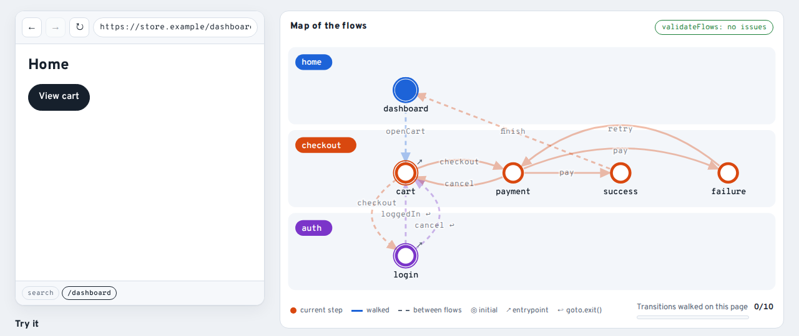

<p align="center">
  
</p>

<p align="center">
  <b>Navigation as data for React.</b> Flows declared as data, typed end to end, with a diagram, generated tests and analytics out of the box.
</p>

<p align="center">
  <a href="https://www.npmjs.com/package/react-flow-app"></a>
  <a href="https://www.npmjs.com/package/react-flow-app"></a>
  <a href="https://github.com/fabio7maia/react-flow-app/actions/workflows/ci-v3.yml"></a>
  <a href="./LICENSE"></a>
  <a href="https://react-flow-app-pr.vercel.app"></a>
</p>

> **Coming from v2?** The model is the same (screens dispatch actions, flows decide where they go) and so are the history rules. What you get:
> navigation as data (diagram, validation, generated tests), a stable event contract with analytics adapters, and a browser back button that
> navigates. [Why v3](https://react-flow-app-pr.vercel.app/why-v3/) · [Migration guide](https://react-flow-app-pr.vercel.app/migration/v2-to-v3/)
>
> v3 is in alpha: `npm install react-flow-app@alpha`. v2 stays on `latest`.

## In 30 seconds

```ts
// A screen: its actions, typed, and a lazy component.
export const paymentScreen = defineScreen({
	name: 'payment',
	actions: { pay: payload<{ ok: boolean }>(), cancel: null },
	loader: () => import('./Payment'),
});

// A flow: where each action goes.
checkoutFlow.transitions({
	payment: {
		pay: branch(['success', 'failure'], (_, p) => (p.ok ? 'success' : 'failure')),
		cancel: 'cart',
	},
});

// The app: one Provider.
<FlowProvider app={flowApp} initial={{ flow: 'checkout' }} adapters={[browserHistory()]} />;
```

[](https://react-flow-app-pr.vercel.app/demo/)

## Features

- 🤳 **Event based**: screens dispatch actions; they never import other screens or call `navigate` ([screens](https://react-flow-app-pr.vercel.app/guides/screens/))
- 🗺️ **A diagram of every flow**, generated from the code ([flows](https://react-flow-app-pr.vercel.app/guides/flows/))
- 🧪 **Generated tests and transition coverage**, from the same graph ([testing](https://react-flow-app-pr.vercel.app/guides/testing/))
- 📈 **Analytics from one event stream**: GA4 and Segment adapters, opt-in actions, consent ([analytics](https://react-flow-app-pr.vercel.app/guides/analytics/))
- 💯 **Typed end to end**: actions, payloads, cross-flow targets, URL params, metadata, events ([typing](https://react-flow-app-pr.vercel.app/guides/typing/))
- 🔗 **URLs, deep links and the browser back button**, through an optional adapter ([URLs](https://react-flow-app-pr.vercel.app/guides/urls/))
- 🧩 **Headless core**: the engine has no DOM and runs in Node tests ([events](https://react-flow-app-pr.vercel.app/guides/events/))

## Install

```bash
npm install react-flow-app@alpha
```

React 18 or 19. The core works without React; the binding lives in `react-flow-app/react`.
Then follow the [quick start](https://react-flow-app-pr.vercel.app/getting-started/quick-start/).

## Links

[Documentation](https://react-flow-app-pr.vercel.app) · [Demo](https://react-flow-app-pr.vercel.app/demo/) · [Storybook](https://fabio7maia.github.io/react-flow-app/v3/) · [Changelog](./CHANGELOG.md) · [RFCs](./rfcs/api-v3)

## Contributing

```bash
yarn test          # engine, event contract, v2 parity, adapters, analytics, testing, CLI, React
yarn typecheck     # types and type tests
yarn storybook     # examples and the demo
yarn docs:dev      # the documentation site
yarn changeset     # describe your change for the changelog
```

See [`examples/store`](./examples/store) for the example used by the tests, the e2e suite and the demo.

## License

MIT
