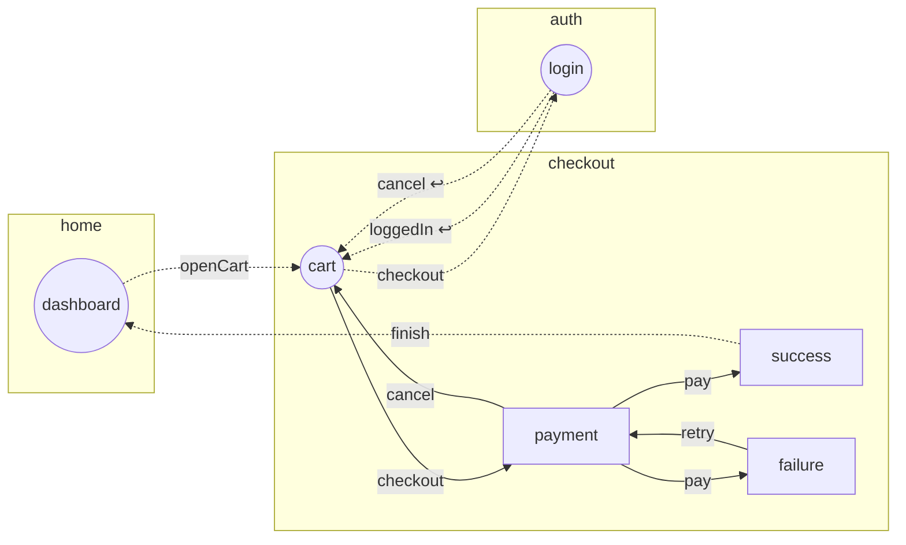

<!-- Generated by `react-flow-app check --write`. Do not edit by hand. -->

# Flows

3 flows, 6 steps, 10 transitions.
`((step))` initial · `{{@overlay}}` overlay · `-.->` between flows · `↩` goto.exit() · `⟲` resumes the flow · `⚙` effect

