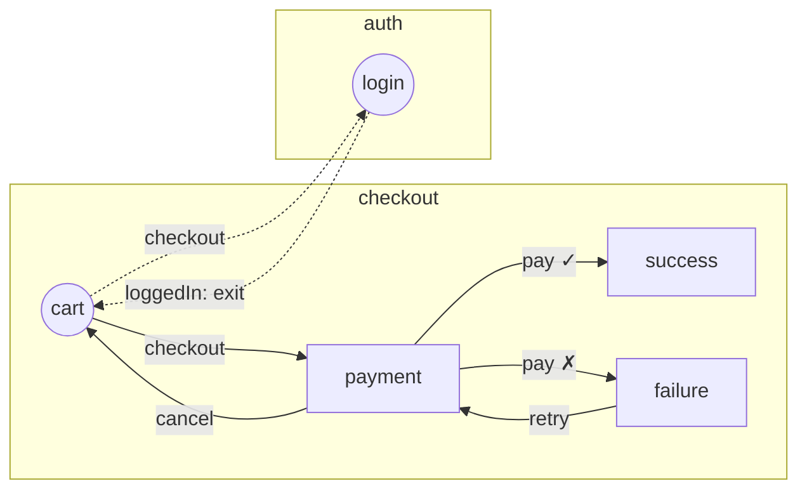

# Abordagem A — Motor próprio com grafo declarativo ("flow as data")

> Parte de um conjunto de 3 abordagens para a v3 do `react-flow-app`. Ver [comparativo](./00-comparativo.md).

## Resumo

Manter um motor próprio, mas reescrito em duas camadas:

1. **Core headless** (`react-flow-app/core`) — TypeScript puro, sem React. Recebe a definição dos ecrãs e flows e expõe uma store imutável (`getSnapshot`/`subscribe`), comandos (`dispatch`, `back`, `start`) e eventos.
2. **Binding React** (`react-flow-app`) — Provider por instância, hooks com seletores, render dos ecrãs com `React.lazy` + View Transitions.

A peça central é que **as transições são dados, não funções**. A lógica condicional escolhe entre destinos _declarados_. Isso torna o grafo completamente analisável sem executar código, o que desbloqueia diagrama, validação estática e geração de testes.

É a evolução natural da ideia do PR #63 (`defineScreens`/`defineFlow`), mas corrigindo o problema de fundo: no PR as transições podem ser funções arbitrárias e o `extractGraph` tem de as **executar** para descobrir o destino.

## Inspiração na comunidade

| Projeto | O que aproveitar |
|---|---|
| Android Navigation Component (navigation graph XML) | Grafo declarativo com destinos e ações; o IDE desenha o grafo a partir da definição |
| XState / statecharts | Guards que escolhem entre alvos declarados (`target` + `guard`) em vez de funções livres |
| React Albus, react-use-wizard | API mínima para wizards lineares — mostra o nível de simplicidade a atingir no caso simples |
| xyflow (React Flow) + dagre/elk | Render interativo do grafo com auto-layout, sem escrever um motor de layout próprio |
| Mermaid | Exportação textual do diagrama para README, PRs e docs |

## Exemplo

Cenário usado nas 3 abordagens: **checkout** (`cart → payment → success | failure`) com salto cross-flow para **auth** (`login`) quando o utilizador não tem sessão.

### Organização em ficheiros

Cada ecrã é declarado no seu ficheiro, cada flow no seu, e a app junta os flows num ponto único:

```
src/
  screens/
    payment/
      payment.screen.ts     ← definição: ações, payloads, meta, loader (leve)
      Payment.tsx           ← componente (carregado em lazy)
    cart/
      cart.screen.ts
      Cart.tsx
    ...
  flows/
    checkout.flow.ts        ← passos + transições do checkout
    auth.flow.ts
  app.flow.ts               ← composição: createFlowApp + Register
```

### Regras de desenho

1. **A definição do ecrã (`*.screen.ts`) fica separada do componente.** O flow importa a definição (dados + `import()`), não o componente. Assim os flows conhecem as ações sem carregar código de UI, e o code-splitting mantém-se.
2. **O ecrã declara o que o utilizador pode fazer; o flow declara para onde isso leva.** Ações, payloads e metadados vivem no ecrã. Passos, regras de histórico e transições vivem no flow. O mesmo ecrã pode ser usado em vários flows, ou duas vezes no mesmo flow com nomes de passo diferentes.
3. **Os saltos entre flows referem o destino por nome** (`goto('auth', 'login')`), sem importar o outro flow. Isto evita imports circulares (o auth pode voltar ao checkout). A validação de tipos é feita contra o registo global (`Register`) declarado na composição.
4. **As transições são declaradas num statement separado do `defineFlow`** (`checkoutFlow.transitions({...})`). O [spike](./spike-findings.md) mostrou que, dentro do `defineFlow`, o `goto` validado pelo `Register` cria uma referência circular de tipos (TS7022). Separadas, o tipo do flow depende só dos `steps` e o ciclo desaparece. É a mesma forma da v2 (`f0.step('x')({...})`).
5. **O `loader` não exige `ComponentType` no tipo** (`default: unknown`, verificado em runtime). Exigir `ComponentType` obriga o TS a inferir o retorno do componente, que usa `useFlow(screen)`, e isso volta a criar um ciclo.

### 1. Ecrãs (um ficheiro por ecrã)

```ts
// screens/payment/payment.screen.ts
import { defineScreen, payload } from 'react-flow-app';

export const paymentScreen = defineScreen({
	name: 'payment',
	actions: { pay: payload<{ ok: boolean }>(), cancel: null }, // null = ação sem payload
	meta: { title: 'Pagamento' },
	loader: () => import('./Payment'),
});
```

```ts
// screens/cart/cart.screen.ts
export const cartScreen = defineScreen({
	name: 'cart',
	actions: { checkout: payload<{ loggedIn: boolean }>() },
	meta: { title: 'Carrinho' },
	loader: () => import('./Cart'),
});
```

`defineScreen` usa `const` type parameters (TS ≥ 5.0), por isso não é preciso `as const`.

```tsx
// screens/payment/Payment.tsx
import { useFlow } from 'react-flow-app';
import { paymentScreen } from './payment.screen';

export default function Payment() {
	const { dispatch, back, canGoBack } = useFlow(paymentScreen);
	return (
		<>
			<button onClick={() => dispatch('pay', { ok: true })}>Pagar</button>
			{/*                     ^ só 'pay' | 'cancel'; o payload de 'pay' é obrigatório */}
			<button onClick={() => dispatch('cancel')}>Cancelar</button>
			{canGoBack && <button onClick={back}>Voltar</button>}
		</>
	);
}
```

A tipagem do `dispatch` vem diretamente da definição do ecrã. Não depende de nenhum flow nem do registo global.

### 2. Flows (um ficheiro por flow)

```ts
// flows/checkout.flow.ts
import { defineFlow, branch, goto } from 'react-flow-app';
import { cartScreen } from '../screens/cart/cart.screen';
import { paymentScreen } from '../screens/payment/payment.screen';
import { successScreen } from '../screens/success/success.screen';
import { failureScreen } from '../screens/failure/failure.screen';

export const checkoutFlow = defineFlow({
	name: 'checkout',
	baseUrl: 'checkout',
	steps: {
		cart: { screen: cartScreen, initial: true, entrypoint: true },
		payment: { screen: paymentScreen, url: 'pay/:orderId' },
		success: { screen: successScreen, clearHistory: true },
		failure: { screen: failureScreen, ignoreHistory: true },
	},
});

// Statement separado: evita a referência circular de tipos com o Register (ver regra 4).
checkoutFlow.transitions({
	cart: {
		// Ramo declarado: o diagrama mostra as 2 arestas sem executar nada.
		// O payload `p` é inferido da ação `checkout` do cartScreen.
		checkout: branch(['payment', goto('auth', 'login')], (_, p) =>
			p.loggedIn ? 'payment' : goto('auth', 'login'),
		),
	},
	payment: {
		// samples: payloads de exemplo por alvo, usados pelos testes gerados a partir do grafo.
		pay: branch(['success', 'failure'], (_, p) => (p.ok ? 'success' : 'failure'), {
			samples: { success: { ok: true }, failure: { ok: false } },
		}),
		cancel: 'cart',
	},
	failure: { retry: 'payment' },
	success: { finish: goto('home', 'dashboard') },
	//                   ^ erro de tipo se 'home' ou 'dashboard' não existirem no registo
});
```

```ts
// flows/auth.flow.ts
export const authFlow = defineFlow({
	name: 'auth',
	baseUrl: 'auth',
	steps: { login: { screen: loginScreen, initial: true } },
});

authFlow.transitions({
	login: { loggedIn: goto.exit() }, // volta ao flow de origem (equivalente ao fromFlow da v2)
});
```

Garantias de tipos:

- `steps.<passo>.screen` liga o passo a um ecrã. O nome do passo não tem de ser igual ao nome do ecrã.
- `transitions.<passo>` só aceita passos declarados em `steps` desse flow.
- As chaves de cada passo são as ações do ecrã ligado a esse passo. Ações sem transição não são erro de compilação (as transições estão num statement à parte), mas são detetadas pelo `validateFlows`.
- Os alvos são `'passo-do-flow' | goto(flow, passo) | goto.exit()`, todos tipados.
- O `branch(targets, resolver)` obriga o resolver a devolver um dos `targets` e infere o payload da ação.

### 3. Composição da app

```ts
// app.flow.ts
import { createFlowApp } from 'react-flow-app';
import { checkoutFlow } from './flows/checkout.flow';
import { authFlow } from './flows/auth.flow';
import { homeFlow } from './flows/home.flow';

export const flowApp = createFlowApp([checkoutFlow, authFlow, homeFlow], {
	transitions: 'view-transition', // usa document.startViewTransition quando existir
});

declare module 'react-flow-app' {
	interface Register {
		app: typeof flowApp; // ativa intellisense global: goto(), useFlowEvents(), start()…
	}
}
```

```tsx
// App.tsx
import { browserHistory, FlowProvider, scrollRestoration, useFlowEvents } from 'react-flow-app';
import { flowApp } from './app.flow';

export function App() {
	useFlowEvents('action', (e) => analytics.track(e.action, { ...e.payload, step: e.step }));
	useFlowEvents('step:enter', (e) => analytics.page(e.meta?.title, e.url));

	// URL e scroll são adaptadores opcionais: o core não depende do DOM (React Native, testes em Node).
	return (
		<FlowProvider
			app={flowApp}
			initial={{ flow: 'checkout' }}
			adapters={[browserHistory({ mode: 'hash' }), scrollRestoration()]}
			fallback={<Spinner />}
		/>
	);
}
```

### 4. Diagrama

```ts
import { toGraph, toMermaid } from 'react-flow-app/diagram';
import { flowApp } from './app.flow';

const graph = toGraph(flowApp); // puro: { nodes, edges }, cada aresta tem action, kind: 'direct' | 'branch' | 'cross-flow' | 'exit'
console.log(toMermaid(graph));
```



Para visualização interativa, um pacote opcional `@react-flow-app/devtools` renderiza o `graph` com **xyflow + elkjs**. Mostra o passo ativo em tempo real e o histórico, e permite saltar para qualquer passo em dev.

### 5. Validação estática (controlo do desenvolvimento)

```ts
import { validateFlows } from 'react-flow-app/diagram';

test('flows são válidos', () => {
	expect(validateFlows(flowApp)).toEqual([]);
	// Deteta: passos inalcançáveis, actions sem transição, flows sem passo inicial,
	// entrypoints com URLs duplicados, ciclos sem saída, goto.exit() em flows que nunca são abertos por outro.
});
```

Isto também corre como CLI em CI (`npx react-flow-app check src/app.flow.ts`). Está implementado na lib (`react-flow-app check`):

- **Snapshot do grafo no repo.** `flows.graph.json` (ordenado, sem payloads de exemplo) e `FLOWS.md` (Mermaid, que o GitHub renderiza). O CI falha se estiverem desatualizados, como num lockfile, por isso o diff de um PR que muda a navegação mostra a mudança no grafo.
- **Diff face à branch base.** `--base origin/v3` lê o snapshot da base com `git show`, sem compilar o código da base. Gera um resumo em markdown para o PR, com:
  - passos novos, removidos ou alterados (ecrã, initial, entrypoint, ações);
  - transições novas e removidas;
  - um Mermaid com o que mudou em destaque.
- **`--strict`.** Os avisos também falham (ex.: `branch` sem `samples`, que deixa os testes gerados sem caminho).

### 6. Testes

**Core sem React** — testes de unidade rápidos e determinísticos:

```ts
import { createFlowEngine } from 'react-flow-app/core';

it('failure não fica no histórico', () => {
	const engine = createFlowEngine(flowApp, { initial: { flow: 'checkout' } });
	engine.dispatch('checkout', { loggedIn: true });
	engine.dispatch('pay', { ok: false });
	engine.back();
	expect(engine.getSnapshot().step).toBe('cart'); // failure foi ignorado
});
```

**Geração de caminhos a partir do grafo** (model-based testing próprio):

```ts
import { getPaths } from 'react-flow-app/testing';

describe.each(getPaths(flowApp, { from: 'checkout.cart', strategy: 'shortest' }))('caminho %s', (path) => {
	it('é navegável', async () => {
		const ui = renderFlow(App); // helper de @testing-library
		for (const step of path.steps) await ui.dispatch(step.action, step.samplePayload);
		expect(ui.currentStep()).toBe(path.target);
	});
});
```

**Testes de tipos** (`expectTypeOf` do Vitest) para garantir que alvos inválidos não compilam.

## Como responde às prioridades

### 1 e 2. Navegação por eventos e integração com terceiros

A lib é dona do motor e por isso emite o [contrato de eventos](./00-comparativo.md#contrato-de-eventos-prioridades-1-e-2) completo (v1, fixado em teste). Todas as navegações (dispatch, back, start, entrada por URL, back do browser) passam pelo motor, logo nenhuma escapa à captura.

```tsx
// App.tsx — analytics como adaptador, ao lado do URL e do scroll
<FlowProvider
	app={flowApp}
	initial={{ flow: 'home' }}
	adapters={[
		browserHistory(),
		scrollRestoration(),
		ga4({
			actions: {
				pay: payload => ({ name: 'payment_submitted', properties: { ok: payload.ok } }),
				//   ^ intellisense: todas as ações de todos os flows; payload inferido: { ok: boolean }
			},
		}),
	]}
/>;

// Integração própria, num componente filho (tipada pelo Register)
useFlowEvents('step:enter', e => sentry.addBreadcrumb({ message: `${e.flow}.${e.step}`, data: e.meta }));

// Ou fora do React, para todas as instâncias (ex.: monitorização)
createFlowApp(flows, {
	integrations: [e => e.type === 'action:unhandled' && console.warn(`ação sem transição: ${e.action}`)],
});
```

### 3. Diagrama multi-fluxo

`toGraph(flowApp)` devolve todos os flows num único grafo. As arestas cross-flow (`goto`) e de saída (`goto.exit()`) vêm marcadas. Daí geram-se:
- Mermaid para docs e PRs;
- o grafo interativo com xyflow + elk;
- um `toXStateMachine(flowApp)` para abrir no Stately visualizer, sem ter o XState como dependência de runtime.

### 4. Testes automáticos e agilidade

```ts
import { createFlowTester, getPaths, transitionCoverage } from 'react-flow-app/testing';

const t = createFlowTester(flowApp, { start: 'checkout' }); // Node puro, sem DOM
t.dispatch('checkout', { loggedIn: true }).dispatch('pay', { ok: false });
t.expectStep('checkout.failure');
t.expectEvents(['action:checkout', 'step:enter:payment', 'action:pay', 'step:enter:failure']);

// Um teste por caminho do grafo (os payloads dos ramos vêm dos `samples` de cada branch)
// + relatório de arestas não cobertas
test.each(getPaths(flowApp, { strategy: 'simple' }))('%s', (path) => createFlowTester(flowApp).run(path).expectReached());
afterAll(() => expect(transitionCoverage()).toBeGreaterThanOrEqual(0.9));
```

### 5. Tipagem ponta a ponta

Os payloads são declarados por ação no ficheiro do ecrã (`payload<T>()`), e a app é registada uma única vez na composição (`Register { app: typeof flowApp }`). A forma em array (`actions: ['finish']`) continua válida para ecrãs cujas ações não têm payload.

A partir daí, sem genéricos manuais:

| Onde | O intellisense sugere / valida |
|---|---|
| `useFlow(paymentScreen)` | a definição importada do ficheiro do ecrã |
| `dispatch('pay', …)` | só `pay` ou `cancel`; o payload de `pay` é obrigatório e é `{ ok: boolean }` |
| `transitions.payment.pay` | só passos do flow, `goto(flow, passo)` válidos, ou `branch` com alvos válidos |
| `useFlowEvents('step:enter', e => …)` | `e.flow`, `e.step` e `e.meta` como unions/tipos concretos |
| `useFlowEvents('action', e => …)` | `e.action === 'pay'` estreita `e.payload` para `{ ok: boolean }` |
| `start({ flow, step })` | `step` restringido aos passos desse `flow` |

Por razões de performance do type-check, a union de eventos tem um membro por nome de ação, e não por flow × passo × ação. O payload fica correlacionado com a ação, mas `e.flow` e `e.step` não se estreitam um ao outro. Com o produto cartesiano, o check de uma app com 300 ecrãs passava de 1,3 s para 8,6 s (ver o [spike](./spike-findings.md#3-a-union-de-eventos-não-pode-ser-um-produto-cartesiano)).

Os payloads também validados em runtime (opcional, `schema: z.object(...)` em vez de `payload<T>()`) tornam-se úteis para analytics: só eventos com payload válido chegam aos terceiros.

## Mapeamento das funcionalidades da v2

| v2 | Abordagem A |
|---|---|
| `fm.flow().steps()` + `f.step()()` | `defineScreen` (um ficheiro por ecrã) + `defineFlow` (um ficheiro por flow) + `createFlowApp([...])` |
| `TStepOptions` (`ignoreHistory`, `clearHistory`, `allowCyclicHistory`, `checkpoint`, `url`) | Mantidas com a **mesma semântica**, cobertas por testes de caracterização |
| Ação como função (`() => f0.navigateTo('x')`) | `branch([...alvos], resolver)` ou `effect(fn)` para efeitos sem navegação |
| `anotherObjects` (modais) | `defineFlow({ ..., overlays: { help: helpScreen } })` + `flow.transitions({ help: { ... } })`. O overlay é um nó do grafo e entra na validação, mas não é passo (não entra no histórico). O `useFlow(helpScreen)` identifica a origem pelo nome do ecrã |
| `navigateTo()` sem passo (retoma o flow) | `goto(flow)` / `start(flow)` sem passo: último passo desse flow, ou o inicial |
| `listen` / `f.listen()` / `onFlowMount` | `useFlowEvents(type, cb)` + `engine.on(type, cb)` com filtro por flow |
| `initialHistory`, `ignoreHistory` no dispatch | Opções de `start`/`dispatch` |
| `withUrl`, `scrollRestoration` | Adaptadores `browserHistory()` e `scrollRestoration()` no `FlowProvider`. O back do browser passa a navegar o flow (`pushState` + `popstate`); a v2 só fazia `replaceState` |
| `fromFlow` + `backExit` | `goto.exit()` + evento `exit` |

## Prós

- **Grafo 100% analisável.** Diagrama, validação, diff de grafos e geração de testes saem todos da mesma fonte, sem executar código.
- **API simples e com o vocabulário do domínio** (ecrãs, ações, passos, histórico). Um dev novo percebe em minutos e não tem de aprender statecharts.
- **Controlo total** da semântica de histórico, que é o diferencial da lib face a routers e wizards genéricos.
- **Zero dependências de runtime.** Bundle pequeno, previsivelmente abaixo de 4 kB gz no core.
- **Migração incremental a partir da v2.** Os conceitos mapeiam 1:1, e um adaptador `fromV2(fm)` permite correr a v2 em cima do core novo.
- **Core headless reutilizável** em React Native, Vue ou testes de Node.

## Contras

- **Reinventa partes que já existem e estão maduras** no XState (guards, path generation, inspector) e nos routers (URL, deep links).
- **Custo de manutenção alto:** motor, tipos avançados, devtools e geração de caminhos ficam todos a cargo do projeto. É arriscado com um maintainer principal.
- **Os tipos avançados** (alvos restritos ao flow, payload inferido do `branch`) são difíceis de escrever bem e podem degradar o tempo do `tsc` em apps com muitos flows.
- **O `branch` obriga a declarar alvos à parte.** É uma pequena fricção face a "uma função qualquer", mas é intencional.
- **A sincronização com o URL continua a ser responsabilidade da lib** (hash/path, `popstate`, SSR).

## Riscos e mitigação

| Risco | Mitigação |
|---|---|
| Semântica de histórico divergir da v2 (como aconteceu no PR #63) | Escrever primeiro testes de caracterização contra a `main` e corrê-los no core novo |
| Tipos lentos | Medido no spike: 1,4 s de check com 300 ecrãs, 2,4 s com 600 e 4,0 s com 1000, crescimento aproximadamente linear. O benchmark (`scripts/bench.mjs`) deve correr em CI |
| Referências circulares de tipos | Regras 4 e 5 (transições separadas, `loader` sem `ComponentType`), cobertas por testes de tipos |
| Scope creep (guards, paralelismo, async) | Fora de scope explícito. Se for preciso, ver abordagem B |

## Esforço estimado

Médio-alto: core + testes de caracterização (≈ 2–3 semanas), binding React (≈ 1–2), diagrama, validação e CLI (≈ 1–2), devtools xyflow (≈ 1–2), migração e docs (≈ 1).

## Fontes

- [React Flow — auto layout (dagre, d3-hierarchy, elk)](https://reactflow.dev/examples/layout/auto-layout)
- [React Albus](https://npmjs.com/package/react-albus)
- [Stately — graph utilities (path generation)](https://prod.stately.ai/docs/graph)
