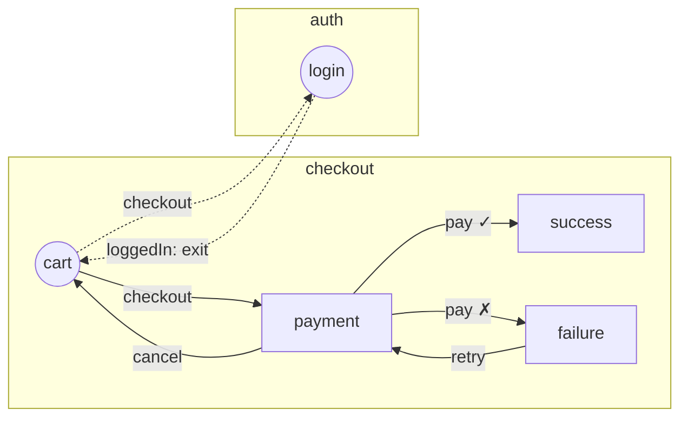

# Abordagem A — Motor próprio com grafo declarativo ("flow as data")

> Parte de um conjunto de 3 abordagens para a v3 do `react-flow-app`. Ver [comparativo](./00-comparativo.md).

## Resumo

Manter um motor próprio, mas reescrito em duas camadas:

1. **Core headless** (`react-flow-app/core`) — TypeScript puro, sem React. Recebe a definição dos ecrãs e flows e expõe uma store imutável (`getSnapshot`/`subscribe`), comandos (`dispatch`, `back`, `start`) e eventos.
2. **Binding React** (`react-flow-app`) — Provider por instância, hooks com seletores, render dos ecrãs com `React.lazy` + View Transitions.

A peça central é que **as transições são dados, não funções**. A lógica condicional escolhe entre destinos _declarados_. Isso torna o grafo completamente analisável sem executar código, o que desbloqueia diagrama, validação estática e geração de testes.

É a evolução natural da ideia do PR #63 (`defineScreens`/`defineFlow`), mas corrigindo o problema de fundo: no PR as transições podem ser funções arbitrárias e o `extractGraph` tem de as **executar** para descobrir o destino.

## Inspiração na comunidade

| Projeto | O que aproveitar |
|---|---|
| Android Navigation Component (navigation graph XML) | Grafo declarativo com destinos e ações; o IDE desenha o grafo a partir da definição |
| XState / statecharts | Guards que escolhem entre alvos declarados (`target` + `guard`) em vez de funções livres |
| React Albus, react-use-wizard | API mínima para wizards lineares — mostra o nível de simplicidade a atingir no caso simples |
| xyflow (React Flow) + dagre/elk | Render interativo do grafo com auto-layout, sem escrever um motor de layout próprio |
| Mermaid | Exportação textual do diagrama para README, PRs e docs |

## Exemplo

Cenário usado nas 3 abordagens: **checkout** (`cart → payment → success | failure`) com salto cross-flow para **auth** (`login`) quando o utilizador não tem sessão.

### 1. Ecrãs

```ts
// screens.ts
import { defineScreens } from 'react-flow-app';

export const screens = defineScreens({
	cart: {
		actions: ['checkout'],
		loader: () => import('./screens/Cart'),
	},
	payment: {
		actions: ['pay', 'cancel'],
		loader: () => import('./screens/Payment'),
	},
	success: { actions: ['finish'], loader: () => import('./screens/Success') },
	failure: { actions: ['retry'], loader: () => import('./screens/Failure') },
	login: { actions: ['loggedIn'], loader: () => import('./screens/Login') },
});
```

`defineScreens` usa um `const` type parameter (TS ≥ 5.0), por isso não é preciso `as const` nas actions.

### 2. Flows

```ts
// flows.ts
import { defineFlows, branch, goto } from 'react-flow-app';
import { screens } from './screens';

export const flows = defineFlows(screens, (flow) => ({
	auth: flow({
		baseUrl: 'auth',
		steps: {
			login: { initial: true, meta: { title: 'Login' } },
		},
		transitions: {
			// "exit" volta ao flow de origem (equivalente ao fromFlow da v2)
			login: { loggedIn: goto.exit() },
		},
	}),

	checkout: flow({
		baseUrl: 'checkout',
		steps: {
			cart: { initial: true, entrypoint: true, meta: { title: 'Carrinho' } },
			payment: { url: 'pay/:orderId', meta: { title: 'Pagamento' } },
			success: { clearHistory: true },
			failure: { ignoreHistory: true },
		},
		transitions: {
			cart: {
				// Ramo declarado: o diagrama mostra as 2 arestas sem executar nada
				checkout: branch(['payment', goto('auth', 'login')], (ctx, payload: { loggedIn: boolean }) =>
					payload.loggedIn ? 'payment' : goto('auth', 'login'),
				),
			},
			payment: {
				pay: branch(['success', 'failure'], (_, p: { ok: boolean }) => (p.ok ? 'success' : 'failure')),
				cancel: 'cart',
			},
			failure: { retry: 'payment' },
			success: { finish: goto('home', 'dashboard') },
			//          ^ erro de tipo se 'home' ou 'dashboard' não existirem
		},
	}),
}));
```

Garantias de tipos:

- `transitions.<step>` só aceita passos declarados em `steps` desse flow.
- As chaves de cada passo são as `actions` do ecrã. Se faltar uma ação, o compilador avisa (opção `strictActions`).
- Os alvos são `'passo-do-flow' | goto(flow, passo) | goto.exit()`, todos tipados.
- O `branch(targets, resolver)` obriga o resolver a devolver um dos `targets`.

### 3. App e ecrãs

```tsx
// app.tsx
import { createFlowApp } from 'react-flow-app';
import { flows } from './flows';

export const { FlowProvider, useFlow, useFlowSelector, useFlowEvents } = createFlowApp(flows, {
	url: { mode: 'hash' }, // 'hash' | 'path' | false — usa replaceState/pushState + popstate
	transitions: 'view-transition', // usa document.startViewTransition quando existir
	scrollRestoration: true,
});

export function App() {
	useFlowEvents('dispatch', (e) => analytics.track(e.action, { ...e.payload, step: e.step }));
	useFlowEvents('enter', (e) => analytics.page(e.meta?.title, e.url));

	return <FlowProvider initial={{ flow: 'checkout' }} fallback={<Spinner />} />;
}
```

```tsx
// screens/Payment.tsx
export default function Payment() {
	const { dispatch, back, canGoBack } = useFlow('payment'); // string literal tipada
	const orderId = useFlowSelector((s) => s.params.orderId); // re-render só quando muda

	return (
		<>
			<button onClick={() => dispatch('pay', { ok: true })}>Pagar</button>
			<button onClick={() => dispatch('cancel')}>Cancelar</button>
			{canGoBack && <button onClick={back}>Voltar</button>}
		</>
	);
}
```

`useFlow('payment')` sabe que o ecrã `payment` tem as actions `pay | cancel`, e o payload de `pay` vem do tipo do resolver do `branch`.

### 4. Diagrama

```ts
import { toGraph, toMermaid } from 'react-flow-app/diagram';
import { flows } from './flows';

const graph = toGraph(flows); // puro: { nodes, edges }, cada aresta tem action, kind: 'direct' | 'branch' | 'cross-flow' | 'exit'
console.log(toMermaid(graph));
```



Para visualização interativa, um pacote opcional `@react-flow-app/devtools` renderiza o `graph` com **xyflow + elkjs**. Mostra o passo ativo em tempo real e o histórico, e permite saltar para qualquer passo em dev.

### 5. Validação estática (controlo do desenvolvimento)

```ts
import { validateFlows } from 'react-flow-app/diagram';

test('flows são válidos', () => {
	expect(validateFlows(flows)).toEqual([]);
	// Deteta: passos inalcançáveis, actions sem transição, flows sem passo inicial,
	// entrypoints com URLs duplicados, ciclos sem saída, goto.exit() em flows que nunca são abertos por outro.
});
```

Isto pode correr também como CLI (`npx react-flow-app check src/flows.ts`) em CI. Produz o Mermaid para colar no PR, ou um diff do grafo entre a branch e a `main`.

### 6. Testes

**Core sem React** — testes de unidade rápidos e determinísticos:

```ts
import { createFlowEngine } from 'react-flow-app/core';

it('failure não fica no histórico', () => {
	const engine = createFlowEngine(flows, { initial: { flow: 'checkout' } });
	engine.dispatch('checkout', { loggedIn: true });
	engine.dispatch('pay', { ok: false });
	engine.back();
	expect(engine.getSnapshot().step).toBe('cart'); // failure foi ignorado
});
```

**Geração de caminhos a partir do grafo** (model-based testing próprio):

```ts
import { getPaths } from 'react-flow-app/testing';

describe.each(getPaths(flows, { from: 'checkout.cart', strategy: 'shortest' }))('caminho %s', (path) => {
	it('é navegável', async () => {
		const ui = renderFlow(App); // helper de @testing-library
		for (const step of path.steps) await ui.dispatch(step.action, step.samplePayload);
		expect(ui.currentStep()).toBe(path.target);
	});
});
```

**Testes de tipos** (`expectTypeOf` do Vitest) para garantir que alvos inválidos não compilam.

## Como responde às prioridades

### 1 e 2. Navegação por eventos e integração com terceiros

A lib é dona do motor e por isso emite o [contrato de eventos](./00-comparativo.md#contrato-de-eventos-prioridades-1-e-2) completo. Todas as navegações (dispatch, back, start, entrada por URL) passam pelo motor, logo nenhuma escapa à captura.

```ts
export const app = createFlowApp(flows, {
	middleware: [
		analytics(ga4Adapter({ measurementId: 'G-XXX' })),
		// Integração própria: um único sítio, totalmente tipado
		(ctx, next) => {
			if (ctx.event.type === 'action' && ctx.event.action === 'pay') {
				//                                                  ^ intellisense: todas as actions de todos os flows
				datadog.addAction('checkout_pay', { ok: ctx.event.payload.ok }); // payload inferido: { ok: boolean }
			}
			return next();
		},
	],
});

// Ou fora do React (ex.: num módulo de telemetria)
app.engine.on('step:enter', (e) => sentry.addBreadcrumb({ message: `${e.flow}.${e.step}`, data: e.meta }));
```

### 3. Diagrama multi-fluxo

`toGraph(flows)` devolve todos os flows num único grafo. As arestas cross-flow (`goto`) e de saída (`goto.exit()`) vêm marcadas. Daí geram-se:
- Mermaid para docs e PRs;
- o grafo interativo com xyflow + elk;
- um `toXStateMachine(flows)` para abrir no Stately visualizer, sem ter o XState como dependência de runtime.

### 4. Testes automáticos e agilidade

```ts
import { createFlowTester, getPaths, transitionCoverage } from 'react-flow-app/testing';

const t = createFlowTester(flows, { start: 'checkout' }); // Node puro, sem DOM
t.dispatch('checkout', { loggedIn: true }).dispatch('pay', { ok: false });
t.expectStep('checkout.failure');
t.expectEvents(['action:checkout', 'step:enter:payment', 'action:pay', 'step:enter:failure']);

// Um teste por caminho do grafo + relatório de arestas não cobertas
test.each(getPaths(flows, { strategy: 'simple' }))('%s', (path) => createFlowTester(flows).run(path).expectReached());
afterAll(() => expect(transitionCoverage()).toBeGreaterThanOrEqual(0.9));
```

### 5. Tipagem ponta a ponta

Os payloads são declarados por ação no ecrã, e os flows são registados uma única vez:

```ts
import { defineScreens, payload } from 'react-flow-app';

export const screens = defineScreens({
	payment: {
		actions: { pay: payload<{ ok: boolean }>(), cancel: null }, // null = sem payload
		loader: () => import('./screens/Payment'),
	},
});

declare module 'react-flow-app' {
	interface Register {
		flows: typeof flows;
		meta: { title: string; funnel?: 'checkout' | 'onboarding' };
	}
}
```

A forma em array (`actions: ['checkout']`, usada nos exemplos acima) continua válida para ecrãs cujas ações não têm payload.

A partir daí, sem genéricos manuais:

| Onde | O intellisense sugere / valida |
|---|---|
| `useFlow('payment')` | só nomes de ecrãs existentes |
| `dispatch('pay', …)` | só `pay` ou `cancel`; o payload de `pay` é obrigatório e é `{ ok: boolean }` |
| `transitions.payment.pay` | só passos do flow, `goto(flow, passo)` válidos, ou `branch` com alvos válidos |
| `useFlowEvents('step:enter', e => …)` | `e.flow`, `e.step` e `e.meta` como unions/tipos concretos |
| `start({ flow, step })` | `step` restringido aos passos desse `flow` |

Os payloads também validados em runtime (opcional, `schema: z.object(...)` em vez de `payload<T>()`) tornam-se úteis para analytics: só eventos com payload válido chegam aos terceiros.

## Mapeamento das funcionalidades da v2

| v2 | Abordagem A |
|---|---|
| `fm.flow().steps()` + `f.step()()` | `defineFlows(screens, flow => …)` |
| `TStepOptions` (`ignoreHistory`, `clearHistory`, `allowCyclicHistory`, `checkpoint`, `url`) | Mantidas com a **mesma semântica**, cobertas por testes de caracterização |
| Ação como função (`() => f0.navigateTo('x')`) | `branch([...alvos], resolver)` ou `effect(fn)` para efeitos sem navegação |
| `anotherObjects` (modais) | `defineScreens({ modal: { actions, kind: 'overlay' } })` — participa no grafo sem ser passo |
| `listen` / `f.listen()` / `onFlowMount` | `useFlowEvents(type, cb)` + `engine.on(type, cb)` com filtro por flow |
| `initialHistory`, `scrollRestoration`, `ignoreHistory` no dispatch | Opções de `start`/`dispatch` |
| `fromFlow` + `backExit` | `goto.exit()` + evento `exit` |

## Prós

- **Grafo 100% analisável.** Diagrama, validação, diff de grafos e geração de testes saem todos da mesma fonte, sem executar código.
- **API simples e com o vocabulário do domínio** (ecrãs, ações, passos, histórico). Um dev novo percebe em minutos e não tem de aprender statecharts.
- **Controlo total** da semântica de histórico, que é o diferencial da lib face a routers e wizards genéricos.
- **Zero dependências de runtime.** Bundle pequeno, previsivelmente abaixo de 4 kB gz no core.
- **Migração incremental a partir da v2.** Os conceitos mapeiam 1:1, e um adaptador `fromV2(fm)` permite correr a v2 em cima do core novo.
- **Core headless reutilizável** em React Native, Vue ou testes de Node.

## Contras

- **Reinventa partes que já existem e estão maduras** no XState (guards, path generation, inspector) e nos routers (URL, deep links).
- **Custo de manutenção alto:** motor, tipos avançados, devtools e geração de caminhos ficam todos a cargo do projeto. É arriscado com um maintainer principal.
- **Os tipos avançados** (alvos restritos ao flow, payload inferido do `branch`) são difíceis de escrever bem e podem degradar o tempo do `tsc` em apps com muitos flows.
- **O `branch` obriga a declarar alvos à parte.** É uma pequena fricção face a "uma função qualquer", mas é intencional.
- **A sincronização com o URL continua a ser responsabilidade da lib** (hash/path, `popstate`, SSR).

## Riscos e mitigação

| Risco | Mitigação |
|---|---|
| Semântica de histórico divergir da v2 (como aconteceu no PR #63) | Escrever primeiro testes de caracterização contra a `main` e corrê-los no core novo |
| Tipos lentos | Benchmarks `tsc --extendedDiagnostics` num fixture com 50 flows / 300 ecrãs |
| Scope creep (guards, paralelismo, async) | Fora de scope explícito. Se for preciso, ver abordagem B |

## Esforço estimado

Médio-alto: core + testes de caracterização (≈ 2–3 semanas), binding React (≈ 1–2), diagrama, validação e CLI (≈ 1–2), devtools xyflow (≈ 1–2), migração e docs (≈ 1).

## Fontes

- [React Flow — auto layout (dagre, d3-hierarchy, elk)](https://reactflow.dev/examples/layout/auto-layout)
- [React Albus](https://npmjs.com/package/react-albus)
- [Stately — graph utilities (path generation)](https://prod.stately.ai/docs/graph)
